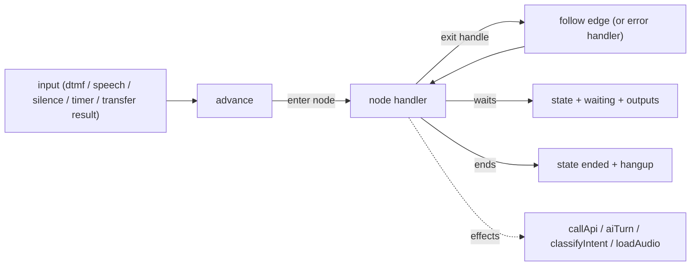

# 0034 — Call flow engine, versions and validation

- **Status:** accepted
- **Date:** 2026-10-12

## Context

Phase 6 lets a client build a call flow (IVR menu + AI agent + API checks + actions) in a visual builder, publish it, and try every branch in a text simulator. The same engine must later drive live calls (Phase 7 voice runtime, Phase 8 campaigns, Phase 10 API-triggered calls, Phase 14 inbound), so it has to be channel-free, deterministic and easy to test.

The AutoChatix automation engine we studied (read-only) showed what not to repeat:

- run state stored **inside contact attributes** (`current_node`, `waiting_for`, hop counters mixed with customer data);
- edges matched by **free-text `condition` strings**, with a **silent fallback** to any unconditioned edge (a typo sends the customer down the wrong branch instead of failing);
- one **3,600-line node switch**;
- hard-coded **reset keywords** (`hi`, `start`, …) that restart a running flow;
- `console.log` of matched edges (customer data in logs) and traces written fire-and-forget, never in simulation;
- **no versioning** (edits change live automations) and **no static validation** before going live.

## Options considered

1. **Own graph format with named exit handles, a pure interpreter with injected effects, an embedded draft + immutable published versions, a static validator** — chosen.
2. **A generic workflow / state-machine library (XState, a BPMN engine)** — powerful, but its model (parallel states, guards as code) is not what a non-technical client edits; persistence and versions still ours.
3. **Run flows as code (generated JS)** — fast, but unsafe to execute client-authored logic and impossible to show in a canvas.

## Decision

Option 1 (details: [PHASE_6_PLAN §1](../phases/PHASE_6_PLAN.md), [PHASE_6_PROMPT §1](../prompts/PHASE_6_PROMPT.md)).

| Area        | Decision                                                                                                                                                                                                                                                                                                                                                                                                                                                                                                                        |
| ----------- | ------------------------------------------------------------------------------------------------------------------------------------------------------------------------------------------------------------------------------------------------------------------------------------------------------------------------------------------------------------------------------------------------------------------------------------------------------------------------------------------------------------------------------- |
| Graph       | `FlowGraph` (`schemaVersion: 1`): nodes `{ id, type, label?, position, config }`, edges `{ id, source, sourceHandle, target }`, flow variables, settings. **Exits are handles** declared per node type (`next`, `key_<id>`, `intent_<id>`, `rule_<id>`, `success`, `paid` …), one edge per handle; every node except start / hang up has an `error` exit. 15 node types with strict zod configs; drafts may hold incomplete configs (they are issues, not errors).                                                              |
| Versions    | The editable draft is embedded on the flow with an optimistic `revision` (stale save → 409 `FLOW_REVISION_CONFLICT`). Publishing validates and writes an **immutable** `FlowVersion` (model hooks refuse updates); restore copies a version back into the draft. Campaigns (Phase 8) will pin a version.                                                                                                                                                                                                                        |
| Validation  | `validateFlow` (pure): 23 issue codes — start rules, invalid / doubled edges, required exits, unreachable nodes, no ending, **silent loops** (strongly connected components of non-waiting nodes), unknown / read-only variables, server-only `{{contact.*}}` outside API nodes, missing / inactive agents, missing audio, DTMF clashes, blocked API addresses, transfer phones, API header rules. Errors block publishing; warnings do not.                                                                                    |
| Interpreter | `advance(graph, state, input, effects, ctx) → { state, outputs, trace, waiting }`. Inputs: `start`, `dtmf`, `speech`, `no_input`, `timer`, `transfer_result`, `hangup`. Outputs are **actions** for the host (`say`, `play`, `listen_dtmf`, `listen_speech`, `ai_reply`, `transfer`, `pause`, `message_queued`, `note`, `hangup`). State is plain JSON. One handler file per node type. Side effects only through `FlowEffects` (`callApi`, `aiStart`, `aiTurn`, `classifyIntent`, `loadAudio`); time only through `ctx.now()`. |
| Safety      | Guards: 300 steps / run, 25 visits / node, 50 auto steps between inputs, max duration, 200 inputs; node errors take the `error` exit or the flow error handler (message → hang up or transfer); engine exceptions end the run (`engine_error`, error name only). Call-mode traces carry no texts.                                                                                                                                                                                                                               |
| AI node     | Phase 5 agent compiled with the node goal as a "Task in this step" block; turns through `runAgentTurn` (wallet / caps / guardrails / tools / per-input idempotent billing); outcome → exit in a fixed order (transfer, paid, promise, callback, wrong number, resolved); max turns / silence → `no_response`; fallbacks → `error`.                                                                                                                                                                                              |
| API node    | Flat `{{name}}` + server-only `{{contact.phone}}` templates, sealed secret headers opened in memory, the Phase 5 SSRF guard (`sendGuardedRequest`); any status is an answer (2xx → `success`, other → `failure`), no answer → `error`.                                                                                                                                                                                                                                                                                          |
| Simulator   | Text host of the same engine: draft snapshot or version, contact or manual values, idempotent inputs, auto timers, transcript + trace + node stats, AI cost.                                                                                                                                                                                                                                                                                                                                                                    |

## Phase 7 host contract

Phase 7 keeps `FlowRunState` in Redis per call and maps actions to audio: `say` → TTS (cached per text + voice), `play` → the converted file, `listen_dtmf` / `listen_speech` → DTMF detection / STT with the timeout (timeouts become `no_input`), `pause` → a timer that sends `timer`, `transfer` → SIP transfer whose result becomes `transfer_result`, `ai_reply` → Realtime audio (the AI node uses the live session instead of `runAgentTurn`), `hangup` → hang up. Node stats switch to `mode: call`; trace rows become `CallEvent`s.

## Benchmarks (2026-10-12, `npm run bench:flow`)

149 nodes / 197 edges, 10,000 `advance` calls with fake effects: p50 77 µs · p95 96 µs · p99 163 µs. `validateFlow` on the same graph: 2.3 ms.

## Consequences

- **Positive:** one engine for every channel; flows are testable without a phone, a database or a model; publishing can't break a running campaign; wrong branches fail loudly (issues / error exits) instead of silently.
- **Negative / trade-offs:** no sub-flows or business-hours node yet; one draft per flow (no co-editing, a conflict dialog instead); the builder must mirror the node schemas (generated from OpenAPI).
- **Follow-ups:** Phase 7 voice host and live built-ins; Phase 8 `isFlowInUse` and version pinning; Phase 9 node reports from `FlowNodeStats` (`mode: call`); Phase 10 sending the queued messages and API triggers; Phase 14 inbound mapping.
