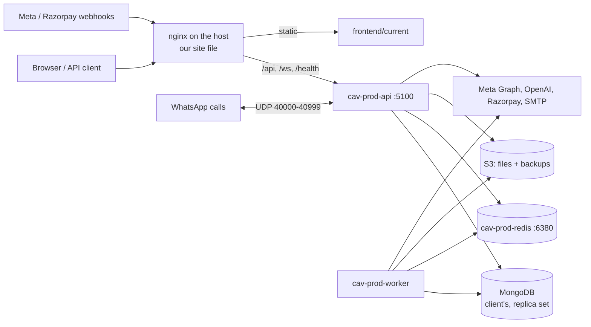

# ADR 0049: Production on the client's shared server

**Status:** Accepted (Phase 17)

## Context

The app runs for the client at `wa.notifynow.in` on the client's server (`154.210.160.233`), which also runs at least one other application of theirs, and on the client's MongoDB. The client's team deploys by pulling the public repo `Cell24x7/cell-ai-voicebot` and rebuilding. Nobody can tell which commit is live (`/health` says `unknown`), there are no off-server backups, no alerts and no rollback. Meta App Review is pending on this production, so its number and review login must keep working.

The staging kit from Phase 13 (ADR 0042) was rehearsed on a laptop but never ran on a server.

## Decision

**Isolation on a shared host.** Our app is the Linux user `cav`, the folder `/srv/cell-ai-voicebot/`, the Compose project `cav-prod`, one nginx site file and two snippets, and two systemd timers. Nothing else on the host is read in detail, restarted or reconfigured by us. Host-wide changes (firewall, SSH, updates, Docker daemon, nginx main config) are made by the client's admin from `docs/ops/host-hardening.md`, unless the owner allows us.

**Processes.** `cav-prod-api` (`WORKERS_ENABLED=false`) and `cav-prod-worker` (`WORKERS_ENABLED=true`) from the same image, plus `cav-prod-redis`. MongoDB stays the client's (it holds the production data) as long as it is a replica set with auth; otherwise it is fixed first, or moved (owner decision). API and worker use host networking because WhatsApp call media binds UDP 40000–40999 on the public interface; HTTP binds `127.0.0.1` only.

| Port            | Use                      | Bound to  |
| --------------- | ------------------------ | --------- |
| 5100            | API                      | 127.0.0.1 |
| 5101            | Worker health            | 127.0.0.1 |
| 6380            | Redis                    | 127.0.0.1 |
| 27018           | Bundled MongoDB, if used | 127.0.0.1 |
| 40000–40999/udp | WhatsApp call media      | public    |

If the server audit finds any of the TCP ports taken, the fallback set is 5200 / 5201 / 6480 / 27118.

**Limits.** API 2 CPU and 2 GB, worker 1.5 CPU and 1.5 GB, Redis 512 MB (`maxmemory 400mb`, `noeviction`, AOF every second), so our app and the client's app can't starve each other. Logs use Docker's `local` driver, 50 MB × 5 per container.

**Releases.** A release is a tag `release-YYYYMMDD-<backend sha7>` in the client repo, made only by `scripts/sync-client-repo.sh`, which refuses to overwrite files the client changed. `release.sh <tag>` on the server: lock → preflight → backup → build with `GIT_SHA` / `BUILT_AT` → migrate → wait for live calls to end → new worker → new API → readiness and commit check → switch → post-deploy checks → record. Any failure after a restart puts the previous release back. Migrations must work with the previous release still running, so a rollback never needs a down-migration.

**Live calls.** A stopped API ends its live calls with the technical line. So `release.sh` waits for the live call count to reach 0, for up to 10 minutes, before stopping the old API, and releases run in a maintenance window. Calls still live after 10 minutes are ended politely and settled by the existing shutdown code.

**Data safety.** Uploads and recordings move to S3. MongoDB is dumped every night and before every release, encrypted with `age` to the owner's key, and stored in S3 with versioning. The server's S3 user can't delete objects, so a compromised server can't erase backups. Restores are drilled on another machine, never on production.

**Watching.** UptimeRobot checks health and the home page every minute from outside. `healthwatch.sh` checks readiness, disk, memory, queues, failed jobs, certificate, backup age, MongoDB primary and container restarts every 5 minutes and e-mails through a one-off container that works when the API is down. Admin → System shows the same facts to superadmins.

## Alternatives

- **Our own server.** Cleanest isolation and our own access, but the client wants it on their server, and production data is already there. Revisit after the pilot.
- **MongoDB Atlas.** Managed backups and monitoring, but moving production data needs a window and the client's approval. Kept as the fallback if the client's MongoDB can't be a replica set with auth.
- **Managed Redis.** Not needed at this size; Redis holds queues and caches that rebuild.
- **PM2 instead of Docker.** The client's other app may use it, but Docker gives us the same image on staging, rehearsal and production, plus resource limits.
- **Blue-green with two API containers.** Needs two port sets and nginx switching on a shared host. The calls wait plus a window gives the same result for this traffic.

## Consequences

- Each release needs the maintenance window and waits for calls; a release can take up to 15 minutes.
- Until SSH access exists, the client's team runs `release.sh`; everything is one command so they don't need to know the details.
- Restore drills, alert tests and capacity runs need a second machine (staging or the owner's Mac), never production.
- Host hardening depends on the client's admin.
