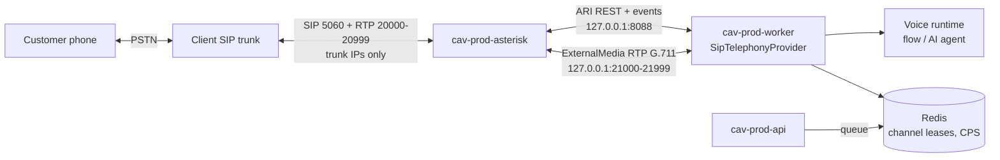

# ADR 0050: SIP on the shared server

**Status:** Accepted (Phase 18)

## Context

Phone calls go out over the client's SIP trunk. Asterisk ([ADR 0022](0022-sip-media-server.md)) terminates SIP and RTP; our Node voice runtime ([ADR 0035](0035-voice-runtime.md)) needs the audio as PCM16 frames behind the `CallLeg` interface ([ADR 0020](0020-telephony-abstraction.md)). Production is the client's shared server ([ADR 0049](0049-production-shared-server.md)), which already carries our API, worker, Redis and the WhatsApp call media on UDP 40000–40999, plus at least one app of the client's. A SIP port open to the internet is scanned within minutes, and toll fraud is the main money risk.

## Decision

**Container.** Asterisk 22 LTS in its own container (`cav-prod-asterisk`, staging `cav-stg-asterisk`, lab `cav-sip-lab-asterisk`), built by us from `deploy/asterisk/Dockerfile`, Compose profile `sip`, so installs on the dry-run line don't start it. Host networking (RTP needs the real addresses), `cpus: 1`, `mem_limit: 512m`, `local` logs 20 MB × 5. Config is rendered from env at start; no secret is in a file in git.

**Ports.**

| Port            | Use                                | Bound to / open to                   |
| --------------- | ---------------------------------- | ------------------------------------ |
| 5060 udp + tcp  | SIP signaling                      | Host; firewall: **trunk IPs only**   |
| 5061 tcp        | SIP TLS (if the trunk has it)      | Host; firewall: trunk IPs only       |
| 20000–20999/udp | Asterisk RTP to the trunk          | Host; firewall: trunk media IPs only |
| 8088            | ARI (REST + events)                | `127.0.0.1`                          |
| 21000–21999/udp | Our RTP ↔ Asterisk (ExternalMedia) | `127.0.0.1`                          |

These don't overlap WhatsApp's 40000–40999. The Asterisk RTP range must hold at least 4 × `SIP_MAX_CHANNELS` ports (even ports only, two per call, two more per transfer): Asterisk 22 crashes when it cannot get one (T18.19). The server audit confirms they are free; fallback ranges are 22000–22999 / 23000–23999.

**Trunk auth.** Both modes are in the template: registration (username + password) or IP `identify` on the trunk's addresses. No anonymous endpoint, no guest calls, unknown sources get no dialplan. Inbound context answers nothing until Phase 19.

**Who owns calls.** The **worker** (`WORKERS_ENABLED=true`) holds the one ARI connection (app `cav`) and the RTP ports, like WhatsApp AI calls today. The API never talks to Asterisk; it queues calls. Channel ids are `cav-<callId>` so a retried job can't create a second call.

**Limits shared by all processes.** Trunk channels (`SIP_MAX_CHANNELS`, default 30) are a Redis lease set; calls per second (`SIP_MAX_CPS`, default 2) a Redis token bucket; account limits stay as today. A transfer leg takes its own channel.

**Safety.** Only `+91` mobile and landline numbers are dialed; a per-account limit of SIP minutes per hour pauses campaigns and alerts. Passwords (SIP, ARI) live only in env files; logs show the last 4 digits of numbers.

**Rollback.** `TELEPHONY_PROVIDER=dryrun` or the account's line set back to dry run (superadmin) stops new SIP calls at once; stopping the `asterisk` container ends live ones (settled as `media_error`). No release needed.

## Alternatives

- **FreeSWITCH.** Higher per-box concurrency, but needs a community module for audio streaming and has not been tried; kept for when Asterisk misses the load target.
- **AudioSocket (TCP) instead of RTP.** Simpler on a host where UDP is awkward; we lose loss / jitter numbers and the codec choice. Fallback.
- **A separate media server.** Cleaner isolation, but one more machine to run and secure; revisit after the pilot or if CPU contention shows in load tests.
- **A hosted voice API (CPaaS).** No SIP to run, but per-minute cost on top of the trunk, and the client already has a trunk.

## Consequences

- One more container and two UDP ranges on the client's host; the client's admin opens SIP / RTP for the trunk IPs only (`docs/ops/host-hardening.md`).
- Releases already wait for live calls (ADR 0049); SIP calls are counted the same way.
- Phone audio is 8 kHz G.711; speech recognition quality is checked at 8 kHz (T18.11).
- Every new call type (inbound in Phase 19) uses the same container and ARI app.
