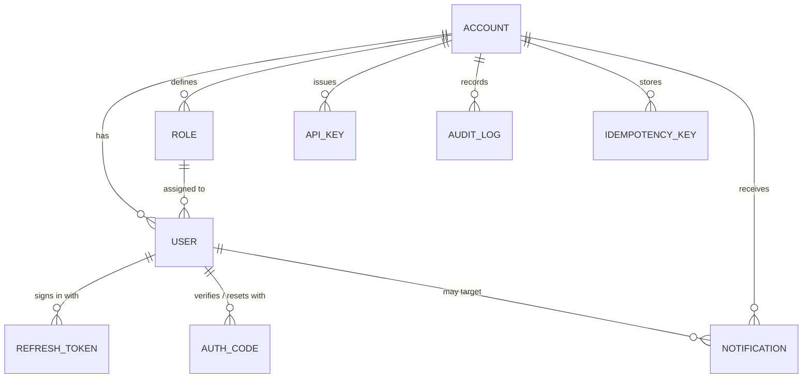
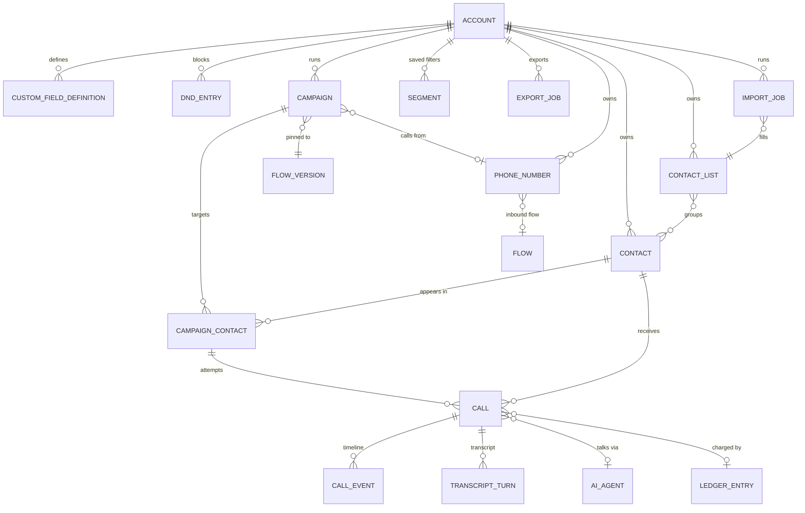
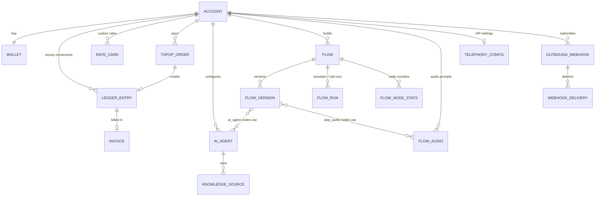

# Core Data Model (draft)

Design draft of every MongoDB collection planned for Phases 1–14. Mongoose models are written phase by phase from this document; when a model deviates, update this file in the same PR.

Rules that apply to every entity are in [data.md](data.md): camelCase fields, `accountId` on every tenant document (first field in compound indexes), `createdAt` / `updatedAt` timestamps, money as `*Micros`, phones as E.164, enums lower_snake_case.

Legend for field tables: **R** = required. All tenant collections also have `_id`, `accountId` (R, indexed), `createdAt`, `updatedAt` — not repeated in every table.

---

## 1. Diagrams

### 1a. Tenancy & auth

### 1b. Contacts, campaigns & calls

### 1c. Wallet, AI, flows & integrations

---

## 2. Entities

### 2.1 Tenancy & auth

#### Account (`accounts`) — Phase 2

Not tenant-scoped (it **is** the tenant): no `accountId`.

| Field                        | Type                                               | R   | Notes                                                                                                                     |
| ---------------------------- | -------------------------------------------------- | --- | ------------------------------------------------------------------------------------------------------------------------- |
| name                         | string                                             | ✓   | Business name                                                                                                             |
| slug                         | string                                             | ✓   | Unique, URL-safe                                                                                                          |
| status                       | `active \| suspended`                              | ✓   | Suspended → no calls, read-only                                                                                           |
| timezone                     | string                                             | ✓   | IANA, default `Asia/Kolkata`                                                                                              |
| country                      | string                                             | ✓   | ISO-3166 alpha-2, default `IN`                                                                                            |
| defaultLanguage              | `hi \| en \| hinglish`                             | ✓   | Default for flows/agents                                                                                                  |
| settings.callingWindow       | `{ start: "09:00", end: "19:00", days: number[] }` | ✓   | Account default; campaigns may narrow it                                                                                  |
| settings.recordingEnabled    | boolean                                            | ✓   | Default true                                                                                                              |
| settings.recordingNotice     | string (≤ 200)                                     | ✓   | Said at the start of recorded calls (Phase 7); default "Yeh call quality ke liye record ki ja rahi hai."                  |
| settings.aiDisclosureEnabled | boolean                                            | ✓   | Default true (compliance)                                                                                                 |
| settings.callCaps            | `{ perDay, perWeek, minGapMinutes }`               | ✓   | Per-contact call caps across campaigns + single calls (Phase 8); default 3 / 10 / 30                                      |
| limits                       | `{ maxConcurrentCalls, dialsPerMinute }`           | ✓   | Dialing limits set by a superadmin (Phase 8); default 10 / 60                                                             |
| whatsapp.metaPayer           | `platform \| customer`                             | ✓   | Who pays Meta for WhatsApp (Phase 9, set by a superadmin): our credit line (default) or the customer's own payment method |
| ownerId                      | ObjectId → users                                   |     | The single owner (set at signup)                                                                                          |
| suspendedAt, suspendReason   | Date, string                                       |     | Set by a superadmin                                                                                                       |
| isPlatform                   | boolean                                            | ✓   | `true` only for the internal `platform` account (holds superadmins; migration 0002)                                       |

Indexes: `{ slug: 1 }` unique, `{ status: 1 }`. Slugs `platform`, `admin`, `api`, `www`, `app`, `support` are reserved. Defaults: timezone `Asia/Kolkata`, country `IN`, language `hinglish`, calling window 09:00–19:00 Mon–Sat. PII: none. Retention: life of contract.

#### User (`users`) — Phase 2

| Field             | Type                                                      | R   | Notes                                                                                      |
| ----------------- | --------------------------------------------------------- | --- | ------------------------------------------------------------------------------------------ |
| name              | string                                                    | ✓   |                                                                                            |
| email             | string                                                    | ✓   | Lowercase, **unique globally**                                                             |
| phone             | string                                                    |     | E.164                                                                                      |
| passwordHash      | string                                                    |     | Null for invited-not-yet-accepted                                                          |
| roleId            | ObjectId → roles                                          | ✓   |                                                                                            |
| status            | `invited \| active \| disabled`                           | ✓   |                                                                                            |
| lastLoginAt       | Date                                                      |     |                                                                                            |
| emailVerifiedAt   | Date                                                      |     | Set by the signup OTP / invite acceptance                                                  |
| tokenVersion      | number                                                    | ✓   | Bumped to invalidate all access tokens (password change, disable, role change, logout-all) |
| platformRole      | `superadmin \| null`                                      |     | Platform admins only (in the `platform` account, created by `npm run superadmin:create`)   |
| invite            | `{ tokenHash, expiresAt, invitedBy, lastSentAt } \| null` |     | Pending invitation (status `invited`)                                                      |
| passwordChangedAt | Date                                                      |     |                                                                                            |
| deletedAt         | Date \| null                                              |     | Soft delete                                                                                |

Indexes: `{ email: 1 }` unique **partial** (`deletedAt: null` — a removed user's email can be invited again), `{ accountId: 1, status: 1 }`, `{ 'invite.tokenHash': 1 }` sparse. JSON never contains `passwordHash`, `tokenVersion`, `invite`. PII: email, phone, name.

#### Role (`roles`) — Phase 2

| Field       | Type     | R   | Notes                                                                                  |
| ----------- | -------- | --- | -------------------------------------------------------------------------------------- |
| key         | string   | ✓   | `owner \| admin \| manager \| agent \| viewer` (custom keys later); unique per account |
| name        | string   | ✓   | Display name                                                                           |
| permissions | string[] | ✓   | e.g. `campaigns.write`, `wallet.topup`                                                 |
| isSystem    | boolean  | ✓   | Built-in owner/admin/manager/agent/viewer (not deletable)                              |

Indexes: `{ accountId: 1, key: 1 }` unique. Permissions come from the catalogue `src/modules/rbac/permissions.ts`; system roles are synced from `SYSTEM_ROLES` (signup + migrations).

#### RefreshToken (`refreshTokens`) — Phase 2

| Field         | Type             | R   | Notes                                                                                                             |
| ------------- | ---------------- | --- | ----------------------------------------------------------------------------------------------------------------- |
| userId        | ObjectId → users | ✓   |                                                                                                                   |
| familyId      | string           | ✓   | Rotation family — reuse of a rotated token revokes the family                                                     |
| tokenHash     | string           | ✓   | Never the raw token                                                                                               |
| expiresAt     | Date             | ✓   | **TTL index**                                                                                                     |
| revokedAt     | Date             |     |                                                                                                                   |
| replacedBy    | ObjectId         |     | Next token in the family                                                                                          |
| userAgent, ip | string           |     | Session list in UI                                                                                                |
| accountId     | ObjectId         | ✓   | Account of the session                                                                                            |
| revokedReason | string           |     | `logout \| logout_all \| rotated \| reuse_detected \| password_changed \| disabled \| removed \| session_revoked` |
| lastUsedAt    | Date             | ✓   |                                                                                                                   |

Indexes: `{ tokenHash: 1 }` unique, `{ userId: 1, familyId: 1 }`, `{ expiresAt: 1 }` TTL (0 s). `tokenHash` = HMAC-SHA256(`JWT_REFRESH_SECRET`, raw token).

#### AuthCode (`authCodes`) — Phase 2

One live code per user and purpose (email OTP or password-reset token), hashed.

| Field                                  | Type                             | R   | Notes                                   |
| -------------------------------------- | -------------------------------- | --- | --------------------------------------- |
| userId                                 | ObjectId → users                 | ✓   |                                         |
| purpose                                | `verify_email \| reset_password` | ✓   |                                         |
| codeHash                               | string                           | ✓   | HMAC of the code / token                |
| attempts                               | number                           | ✓   | Wrong tries (max 5 for OTPs)            |
| sentCount, sendWindowStart, lastSentAt | number, Date, Date               | ✓   | Resend cooldown (60 s) + hourly cap (5) |
| expiresAt                              | Date                             | ✓   | **TTL** — OTP 10 min, reset 30 min      |
| usedAt                                 | Date                             |     | Single use                              |

Indexes: `{ userId: 1, purpose: 1 }` unique, `{ codeHash: 1 }`, `{ expiresAt: 1 }` TTL. Not tenant-scoped (looked up before login).

#### ApiKey (`apiKeys`) — Phase 2/10

| Field      | Type             | R   | Notes                                       |
| ---------- | ---------------- | --- | ------------------------------------------- |
| name       | string           | ✓   |                                             |
| prefix     | string           | ✓   | First chars, shown in UI (`cav_live_ab12…`) |
| keyHash    | string           | ✓   | SHA-256 of the full key; raw key shown once |
| scopes     | string[]         | ✓   | `calls:write`, `contacts:write`, …          |
| lastUsedAt | Date             |     |                                             |
| revokedAt  | Date             |     |                                             |
| createdBy  | ObjectId → users | ✓   |                                             |

Indexes: `{ keyHash: 1 }` unique, `{ accountId: 1, revokedAt: 1 }`.

#### AuditLog (`auditLogs`) — Phase 2

| Field  | Type                                                                  | R   | Notes                                                                            |
| ------ | --------------------------------------------------------------------- | --- | -------------------------------------------------------------------------------- |
| actor  | `{ type: user \| api_key \| system, id, impersonatorId?, platform? }` | ✓   | `impersonatorId` = superadmin acting as the user; `platform` = superadmin action |
| action | string                                                                | ✓   | `campaign.started`, `wallet.adjusted`, …                                         |
| target | `{ type, id }`                                                        |     |                                                                                  |
| meta   | object                                                                |     | No PII values                                                                    |
| ip     | string                                                                |     |                                                                                  |
| at     | Date                                                                  | ✓   |                                                                                  |

Indexes: `{ accountId: 1, at: -1 }`, `{ accountId: 1, action: 1, at: -1 }`. **Immutable** (model hooks reject updates / deletes; only the purge job deletes with `allowPurge`). Action catalogue: [audit.md](audit.md) (Phase 2 · T2.10). Retention: 1 year (purge job).

#### IdempotencyKey (`idempotencyKeys`) — Phase 1

| Field          | Type                       | R   | Notes                           |
| -------------- | -------------------------- | --- | ------------------------------- |
| key            | string                     | ✓   | Client `Idempotency-Key` header |
| method, path   | string                     | ✓   |                                 |
| requestHash    | string                     | ✓   | SHA-256 of the body             |
| status         | `in_progress \| completed` | ✓   |                                 |
| responseStatus | number                     |     |                                 |
| responseBody   | object                     |     | Replayed on retry               |
| expiresAt      | Date                       | ✓   | **TTL**, 24 h                   |

Indexes: `{ accountId: 1, key: 1 }` unique, `{ expiresAt: 1 }` TTL.

#### Notification (`notifications`) — Phase 4

| Field       | Type             | R   | Notes                                                                                                                                                                    |
| ----------- | ---------------- | --- | ------------------------------------------------------------------------------------------------------------------------------------------------------------------------ |
| userId      | ObjectId → users | ✓   | **One row per recipient** (fan-out at creation, so each user has their own read state)                                                                                   |
| type        | string           | ✓   | `wallet.low_balance`, `wallet.exhausted`, `wallet.topup_paid`, `wallet.adjusted`, `billing.*`, `campaign.completed`, `campaign.paused`, `campaign.run_skipped` (Phase 8) |
| title, body | string           | ✓   | ≤ 120 / ≤ 500                                                                                                                                                            |
| link        | string           |     | In-app route                                                                                                                                                             |
| readAt      | Date             |     |                                                                                                                                                                          |
| expiresAt   | Date             | ✓   | **TTL** (90 days), hidden                                                                                                                                                |

Indexes: `{ accountId: 1, userId: 1, readAt: 1, createdAt: -1 }`, `{ expiresAt: 1 }` TTL. Recipients of account-wide notices are resolved server-side by permission (e.g. users with `wallet.read`).

### 2.2 Contacts

Phase 3 ([PHASE_3_PLAN.md](../phases/PHASE_3_PLAN.md) §1). All collections are tenant-scoped (`accountId`, indexed).

#### Contact (`contacts`) — Phase 3

| Field           | Type                                              | R   | Notes                                                                                                                                            |
| --------------- | ------------------------------------------------- | --- | ------------------------------------------------------------------------------------------------------------------------------------------------ |
| phoneE164       | string                                            | ✓   | Unique per account among live contacts (ADR 0018)                                                                                                |
| name            | string \| null                                    |     | ≤ 120, Unicode                                                                                                                                   |
| email           | string \| null                                    |     | lower-case                                                                                                                                       |
| externalId      | string \| null                                    |     | Client's loan / CRM id — unique per account when set                                                                                             |
| variables       | `Map<key, string \| number>`                      | ✓   | Typed by `customFieldDefinitions`: text / phone / date (`YYYY-MM-DD`) as string, number as number, **currency as integer micros**. Sensitive PII |
| tags            | string[]                                          | ✓   | lower-case, ≤ 20; no Tag collection                                                                                                              |
| listIds         | ObjectId[] → contactLists                         | ✓   | ≤ 50                                                                                                                                             |
| dnd             | boolean                                           | ✓   | Mirrors `dndEntries` for fast filtering                                                                                                          |
| optedOutAt      | Date \| null                                      |     | Opt-out also creates a DND entry                                                                                                                 |
| consent         | `{ source, at }` \| null                          |     | Compliance (T0.18)                                                                                                                               |
| source          | `{ type: manual \| import \| api, importJobId? }` | ✓   | First creation                                                                                                                                   |
| searchText      | string                                            | ✓   | lower-case name + email + phone digits + externalId; **never serialised**                                                                        |
| lastCalledAt    | Date \| null                                      |     | Last campaign / single call (Phase 8)                                                                                                            |
| callCount       | number                                            | ✓   | Calls made to the contact (Phase 8)                                                                                                              |
| lastDisposition | string \| null                                    |     | Disposition of the last answered call (Phase 8; segment filter)                                                                                  |
| deletedAt       | Date \| null                                      |     | Soft delete; re-creating the phone revives the document; hard-deleted after 30 days                                                              |

Indexes: `{ accountId, phoneE164 }` unique partial (`deletedAt: null`), `{ accountId, externalId }` unique partial (string, live), `{ accountId, deletedAt, createdAt: -1 }`, `{ accountId, listIds }`, `{ accountId, tags }`, `{ accountId, dnd }`, `{ accountId, name }` (collation `en`, strength 2). PII: phone, name, email, variables, searchText. Retention: until deleted by the client (+ 30-day purge of soft-deleted contacts).

#### ContactList (`contactLists`) — Phase 3

| Field       | Type                                           | R   | Notes                                       |
| ----------- | ---------------------------------------------- | --- | ------------------------------------------- |
| name        | string                                         | ✓   | Unique per account (case-insensitive, live) |
| description | string \| null                                 |     |                                             |
| source      | `{ type: upload \| api \| manual, fileName? }` | ✓   |                                             |
| deletedAt   | Date \| null                                   |     | Soft delete; members keep their contacts    |

Indexes: `{ accountId, name }` unique partial (collation `en` / 2). **No stored counter** — counts are computed on read (no drift).

#### CustomFieldDefinition (`customFieldDefinitions`) — Phase 3

| Field        | Type                                          | R   | Notes                                                                       |
| ------------ | --------------------------------------------- | --- | --------------------------------------------------------------------------- |
| key          | string                                        | ✓   | `^[a-z][a-z0-9_]{0,39}$`, unique per account, immutable; `{{key}}` in flows |
| label        | string                                        | ✓   |                                                                             |
| type         | `text \| number \| date \| currency \| phone` | ✓   | Changeable only while no contact has a value                                |
| required     | boolean                                       | ✓   |                                                                             |
| defaultValue | string \| number \| null                      |     | Stored form (currency micros, date `YYYY-MM-DD`)                            |
| order        | number                                        | ✓   | Display order                                                               |

Indexes: `{ accountId, key }` unique, `{ accountId, order }`. Max 50 per account.

#### Segment (`segments`) — Phase 3

| Field     | Type             | R   | Notes                                 |
| --------- | ---------------- | --- | ------------------------------------- |
| name      | string           | ✓   | Unique per account (case-insensitive) |
| filter    | `ContactFilter`  | ✓   | Evaluated at query time               |
| createdBy | ObjectId → users | ✓   |                                       |

Indexes: `{ accountId, name }` unique (collation `en` / 2). Max 100 per account.

#### DndEntry (`dndEntries`) — Phase 3

| Field     | Type                                  | R   | Notes                   |
| --------- | ------------------------------------- | --- | ----------------------- |
| phoneE164 | string                                | ✓   | Unique per account      |
| reason    | string \| null                        |     |                         |
| source    | `manual \| upload \| keyword \| dtmf` | ✓   | e.g. customer pressed 9 |
| addedBy   | ObjectId → users \| null              |     |                         |

Indexes: `{ accountId, phoneE164 }` unique, `{ accountId, createdAt: -1 }`. PII: phone.

#### ImportJob (`importJobs`) — Phase 3

| Field                                                       | Type                                                                                            | R   | Notes                                     |
| ----------------------------------------------------------- | ----------------------------------------------------------------------------------------------- | --- | ----------------------------------------- |
| kind                                                        | `contacts \| dnd`                                                                               | ✓   |                                           |
| fileName, fileType, fileSize                                | string, `csv \| xlsx`, number                                                                   | ✓   |                                           |
| fileKey                                                     | string \| null                                                                                  |     | Storage key (hidden); cleared when purged |
| sheet, sheets                                               | string, string[]                                                                                |     | xlsx only                                 |
| columns                                                     | `[{ index, header, samples[] }]`                                                                | ✓   | Samples are PII — purged with the file    |
| rowCount                                                    | number                                                                                          | ✓   |                                           |
| mapping, options                                            | object                                                                                          |     | Validated by the contact-imports module   |
| status                                                      | `uploaded \| mapped \| validating \| validated \| importing \| completed \| failed \| canceled` | ✓   |                                           |
| progress                                                    | `{ processed, total }`                                                                          | ✓   | Checkpoint for resume                     |
| totals                                                      | `{ rows, created, updated, unchanged, invalid, duplicates, dnd }`                               | ✓   |                                           |
| problemRows                                                 | `[{ row, reasons[] }]`                                                                          | ✓   | ≤ 100, **no cell values**                 |
| errorReportKey                                              | string \| null                                                                                  |     | Error CSV in storage (hidden)             |
| listId                                                      | ObjectId \| null                                                                                |     | Target list                               |
| warnings, errorMessage                                      | string[], string                                                                                |     | No PII                                    |
| cancelRequested                                             | boolean                                                                                         | ✓   | Hidden                                    |
| createdBy                                                   | ObjectId → users                                                                                | ✓   |                                           |
| startedAt, completedAt, failedAt, canceledAt, filesPurgedAt | Date                                                                                            |     |                                           |

Indexes: `{ accountId, createdAt: -1 }`, `{ status, completedAt }`. Retention: file + error report + samples deleted 30 days after the job ends; the document (totals) stays.

#### ExportJob (`exportJobs`) — Phase 3 (+ campaign results, Phase 8)

| Field                  | Type                                                  | R   | Notes                                                           |
| ---------------------- | ----------------------------------------------------- | --- | --------------------------------------------------------------- |
| kind                   | `contacts \| campaign_results`                        | ✓   | Phase 8; default `contacts`                                     |
| campaignId             | ObjectId \| null                                      |     | Campaign of a `campaign_results` export                         |
| format                 | `csv \| xlsx`                                         | ✓   | Default `csv`                                                   |
| includePhone           | boolean                                               | ✓   | Full phones (creator had `contacts.export`), else last 4 digits |
| scope                  | `ids \| filter \| list \| segment \| campaign`        | ✓   | `campaign` for campaign results                                 |
| filter                 | `ContactFilter`                                       | ✓   | Resolved at creation                                            |
| columns                | string[]                                              | ✓   |                                                                 |
| status                 | `pending \| processing \| ready \| failed \| expired` | ✓   |                                                                 |
| progress               | `{ processed, total }`                                | ✓   |                                                                 |
| rowCount               | number                                                | ✓   |                                                                 |
| fileKey                | string \| null                                        |     | Hidden; CSV with PII                                            |
| createdBy              | ObjectId → users                                      | ✓   |                                                                 |
| completedAt, expiresAt | Date                                                  |     | File deleted at `expiresAt` (24 h)                              |

Indexes: `{ accountId, createdAt: -1 }`, `{ status, expiresAt }`.

### 2.3 Wallet & billing

Money is integer **micros** (₹1 = 1,000,000 — ADR 0016), percentages are **basis points** (1 % = 100 bps). All writes go through `src/core/billing/engine.ts` in one transaction with their ledger rows (ADR 0032).

#### Wallet (`wallets`) — Phase 4

| Field                     | Type                                                    | R   | Notes                                                                    |
| ------------------------- | ------------------------------------------------------- | --- | ------------------------------------------------------------------------ |
| accountId                 | ObjectId → accounts                                     | ✓   | **Unique** — one wallet per account (created at signup / migration 0005) |
| currency                  | `INR`                                                   | ✓   |                                                                          |
| balanceMicros             | number                                                  | ✓   | Real money; below 0 only after a call overran its hold                   |
| holdMicros                | number                                                  | ✓   | Reserved for running calls (≥ 0)                                         |
| creditLimitMicros         | number                                                  | ✓   | Default 0; holds may use it, AI / TTS charges never                      |
| lowBalanceThresholdMicros | number                                                  | ✓   | Default ₹500; 0 = alerts off                                             |
| budgets                   | `{ monthlyCallMicros, monthlyAiMicros }`                | ✓   | 0 = unlimited                                                            |
| spend                     | `{ month: 'YYYY-MM', callMicros, aiMicros, ttsMicros }` | ✓   | Month in the account timezone; reset when a new month starts             |
| alerts                    | `{ lowBalanceNotifiedAt, exhaustedNotifiedAt }`         | ✓   | Hidden — once-per-24 h alert claims                                      |
| version                   | number                                                  | ✓   | Hidden — bumped on every change                                          |

Derived in the API: `availableMicros = balance + creditLimit − hold`, `status` `ok | low | exhausted`.

#### LedgerEntry (`ledgerEntries`) — Phase 4 — **insert-only**

| Field                     | Type                                                                                                                                    | R   | Notes                                                      |
| ------------------------- | --------------------------------------------------------------------------------------------------------------------------------------- | --- | ---------------------------------------------------------- |
| type                      | `topup \| call_charge \| ai_charge \| tts_charge \| adjustment \| refund \| subscription \| recording_charge`                           | ✓   |                                                            |
| direction                 | `credit \| debit`                                                                                                                       | ✓   |                                                            |
| status                    | `held \| captured \| released`                                                                                                          | ✓   | **Only allowed mutation: `held → released`** (model guard) |
| amountMicros              | number                                                                                                                                  | ✓   | > 0, never changes                                         |
| currency                  | `INR`                                                                                                                                   | ✓   |                                                            |
| balanceAfterMicros        | number                                                                                                                                  |     | Wallet balance right after a captured row                  |
| breakdown                 | `{ telephonyMicros, aiMicros, ttsMicros, commissionMicros, answered, durationSec, billableSeconds, pulseSeconds, aiSeconds, ttsChars }` |     | Call / usage charges                                       |
| ref                       | `{ type: call \| campaign \| topup \| manual \| simulator \| usage \| seed, id }`                                                       | ✓   |                                                            |
| holdId                    | ObjectId → ledgerEntries                                                                                                                |     | Charge → its hold; extension hold → the first hold row     |
| rateCardId                | ObjectId → rateCards                                                                                                                    |     | Prices used (snapshot reference)                           |
| idempotencyKey            | string                                                                                                                                  | ✓   | Unique per account, hidden — repeats return the stored row |
| note                      | string                                                                                                                                  |     | Adjustment reason                                          |
| createdBy                 | ObjectId → users                                                                                                                        |     | Null for system                                            |
| releasedAt, releaseReason | Date, string                                                                                                                            |     | Set by the release                                         |

A call settle = release the hold rows + insert a `captured` charge row (amounts are never edited). Indexes: `{ accountId: 1, idempotencyKey: 1 }` unique, `{ accountId: 1, createdAt: -1, _id: -1 }`, `{ accountId: 1, ref.type: 1, ref.id: 1 }`, `{ status: 1, createdAt: 1 }` (reaper), `{ holdId: 1 }`. Retention: forever (financial record).

#### RateCard (`rateCards`) — Phase 4

| Field                  | Type             | R   | Notes                                                      |
| ---------------------- | ---------------- | --- | ---------------------------------------------------------- |
| accountId              | ObjectId \| null |     | **Null = platform default** (exception to the tenant rule) |
| callPerMinuteMicros    | number           | ✓   | Selling price per call minute                              |
| pulseSeconds           | `15 \| 30 \| 60` | ✓   | Billing rounding of answered calls                         |
| aiPerMinuteMicros      | number           | ✓   | Billed per second of AI use                                |
| ttsPer1kCharsMicros    | number           | ✓   |                                                            |
| commissionBps          | number           | ✓   | 0–10,000                                                   |
| billUnansweredAttempts | boolean          | ✓   | Default false                                              |
| inheritsDefault        | boolean          | ✓   | Account row meaning "use the platform default again"       |
| effectiveFrom          | Date             | ✓   | Insert-only history; latest `effectiveFrom ≤ now` wins     |
| createdBy, note        | ObjectId, string |     |                                                            |

Indexes: `{ accountId: 1, effectiveFrom: -1 }`. Migration 0005 inserts the platform default.

#### TopupOrder (`topupOrders`) — Phase 4

| Field                                                                  | Type                                                           | R   | Notes                                          |
| ---------------------------------------------------------------------- | -------------------------------------------------------------- | --- | ---------------------------------------------- |
| provider                                                               | `razorpay \| fake`                                             | ✓   | `fake` only outside production                 |
| providerOrderId, providerPaymentId                                     | string                                                         |     | Unique per provider when set (partial indexes) |
| baseMicros, cgstMicros, sgstMicros, igstMicros, taxMicros, totalMicros | number                                                         | ✓   | Base credited to the wallet; GST on top        |
| status                                                                 | `creating \| created \| paid \| failed \| expired \| refunded` | ✓   |                                                |
| failureReason                                                          | string                                                         |     |                                                |
| buyer                                                                  | billing profile snapshot                                       | ✓   | Invoice buyer                                  |
| createdBy                                                              | ObjectId → users                                               | ✓   |                                                |
| paidAt, ledgerEntryId, invoiceId                                       |                                                                |     | Set when credited                              |
| rawProviderStatus                                                      | string                                                         |     | Hidden                                         |

Indexes: `{ provider, providerOrderId }` / `{ provider, providerPaymentId }` unique partial, `{ accountId: 1, createdAt: -1 }`, `{ status: 1, createdAt: 1 }`. Retention: forever.

#### Invoice (`invoices`) — Phase 4

| Field         | Type                                                                         | R   | Notes                                        |
| ------------- | ---------------------------------------------------------------------------- | --- | -------------------------------------------- |
| number        | string                                                                       | ✓   | `CAV/26-27/000001`, unique, ≤ 16 chars (GST) |
| fy            | string                                                                       | ✓   | Indian financial year (IST), `26-27`         |
| topupOrderId  | ObjectId                                                                     | ✓   | Unique                                       |
| ledgerEntryId | ObjectId                                                                     | ✓   |                                              |
| seller        | `{ name, address, gstin, stateCode }`                                        | ✓   | Snapshot from env                            |
| buyer         | billing profile snapshot                                                     | ✓   |                                              |
| placeOfSupply | `{ stateCode, stateName }`                                                   | ✓   |                                              |
| sacCode       | string                                                                       | ✓   |                                              |
| amounts       | `{ baseMicros, cgstMicros, sgstMicros, igstMicros, taxMicros, totalMicros }` | ✓   | CGST + SGST (same state) or IGST             |
| paymentId     | string                                                                       | ✓   |                                              |
| issuedAt      | Date                                                                         | ✓   |                                              |
| status        | `rendering \| ready \| failed`                                               | ✓   | PDF rendered by a job                        |
| pdfFileKey    | string                                                                       |     | Hidden; download via signed URL              |

Indexes: `{ number: 1 }` unique, `{ topupOrderId: 1 }` unique, `{ accountId: 1, createdAt: -1 }`. Retention: 8 years (tax records — confirm with CA).

#### InvoiceCounter (`invoiceCounters`) — Phase 4

`{ _id: '<fy>', seq }` — `$inc` inside the credit transaction (consecutive numbers, an aborted transaction consumes none). Platform-wide (one GST series per seller).

#### PaymentEvent (`paymentEvents`) — Phase 4

Provider webhook deliveries: `provider`, `eventId` (unique per provider), `type`, `accountId?`, `topupOrderId?`, `providerOrderId?`, `providerPaymentId?`, `outcome` (`received \| credited \| duplicate_credit \| failed \| unmatched \| mismatch \| refund \| ignored`), `receivedAt`, `processedAt`, `expiresAt` (TTL 90 days).

#### Account billing profile (`accounts.billing`) — Phase 4

`{ legalName, email, addressLine1, addressLine2?, city, stateCode, pin, gstin?, updatedAt }` — Latin text only (the invoice PDF can't shape Devanagari); GSTIN checksum + state validated by the API.

### 2.4 AI & flows

#### AiAgent (`aiAgents`) — Phase 5

| Field                             | Type                                                                                                                             | R   | Notes                                                                                               |
| --------------------------------- | -------------------------------------------------------------------------------------------------------------------------------- | --- | --------------------------------------------------------------------------------------------------- |
| name, description                 | string (≤ 80 / ≤ 300)                                                                                                            | ✓   | Name unique per account, case-insensitive (collation index, deleted agents excluded)                |
| persona, openingLine, closingLine | string (≤ 8,000 / ≤ 500 / ≤ 500)                                                                                                 |     | Support `{{variables}}` from `allowedVariables` + `{{company}}`                                     |
| isActive, templateKey             | boolean, string \| null                                                                                                          | ✓   |                                                                                                     |
| allowedVariables                  | string[]                                                                                                                         | ✓   | Contact data the model may see (`name`, `phone_last4`, custom field keys); default `['name']`       |
| voice                             | OpenAI Realtime voice                                                                                                            | ✓   | Used in Phase 7                                                                                     |
| languageMode, language            | `auto \| fixed`, `hi \| en \| hinglish`                                                                                          | ✓   |                                                                                                     |
| toneRules                         | `{ when, customWhen?, respond }[]` (≤ 10)                                                                                        |     |                                                                                                     |
| callBehaviour                     | `{ maxCallDurationSec, silenceTimeoutSec, bargeIn, endCallAfterSilenceRetries }`                                                 | ✓   | Phase 7                                                                                             |
| model                             | `{ textModel, temperatureTenths (0–12), maxOutputTokens }`                                                                       | ✓   | `textModel` from `AI_TEXT_MODELS`                                                                   |
| limits                            | `{ dailySpendCapMicros, monthlySpendCapMicros, onCap: stop \| fallback }`                                                        | ✓   | 0 = no cap                                                                                          |
| guardrails                        | `{ neverSay[], disclosureLine, complianceMode: recovery \| general }`                                                            | ✓   |                                                                                                     |
| fallback                          | `{ aiFailed, walletEmpty, agentOff, capReached }`                                                                                | ✓   |                                                                                                     |
| knowledge                         | `{ knowledgeBaseIds (≤ 3), topK, minScoreHundredths }`                                                                           | ✓   |                                                                                                     |
| functions                         | embedded `{ name, description, parameters[], method, url, headers[], bodyTemplate, resultPath, responseHint, timeoutMs }` (≤ 10) |     | Secret headers: `sealed` (AES-256-GCM, `ENCRYPTION_KEY`) + `valueHint` (`••••1234`); never returned |
| builtInTools                      | `{ endCall, transferToHuman, setDisposition, scheduleCallback, savePromiseToPay, sendSmsAfterCall }`                             | ✓   | Simulated in the playground (Phase 5)                                                               |
| createdBy, updatedBy, deletedAt   | ObjectId, ObjectId, Date \| null                                                                                                 |     | Soft delete; hard-deleted after 30 days (`agents.purge_deleted`)                                    |

Indexes: `{ accountId, name }` unique (partial `deletedAt: null`, collation strength 2), `{ accountId, isActive }`, `{ accountId, updatedAt: -1 }`.

#### KnowledgeBase (`knowledgeBases`) — Phase 5

`{ name (unique per account, case-insensitive), description, version, sourcesCount, chunksCount, embeddingModel, status: ok | stale, createdBy }` — `version` bumps on every source change (vector caches key on it). ≤ 10 per account.

#### KnowledgeSource (`knowledgeSources`) — Phase 5

| Field                   | Type                                                              | R   | Notes                                           |
| ----------------------- | ----------------------------------------------------------------- | --- | ----------------------------------------------- |
| kbId                    | ObjectId → knowledgeBases                                         | ✓   |                                                 |
| kind, fileType          | `file \| url`, `pdf \| docx \| txt \| md \| null`                 | ✓   |                                                 |
| title, url              | string                                                            | ✓   |                                                 |
| fileKey                 | string \| null                                                    |     | Private storage key (hidden)                    |
| bytes, chars, chunks    | number                                                            | ✓   |                                                 |
| status, progress, error | `queued \| processing \| ready \| failed \| stale`, 0–100, string | ✓   | Live via WS `kb.source.updated`                 |
| version, embeddingModel | number, string                                                    | ✓   | Chunks of the current version are the live ones |

Indexes: `{ accountId, kbId, createdAt: -1 }`. ≤ 25 per knowledge base.

#### KnowledgeChunk (`knowledgeChunks`) — Phase 5

`{ kbId, sourceId, sourceVersion, order, title, text (≤ 4,000), embedding number[] (unit length, hidden), dims, model }` — indexes `{ kbId, sourceId, sourceVersion, order }`, `{ accountId, kbId }`. ≤ 2,000 per knowledge base. Searched in process (cosine = dot product), ADR 0033.

#### AgentPlaygroundSession (`agentPlaygroundSessions`) — Phase 5 — TTL 30 days

`{ agentId, userId, contactId?, variables (allowed values only), testPhone (select: false — functions only, never to the model, never returned), turns[] (role, text, toolCalls (redacted), knowledge refs, tokens, costMicros, billing, guardrail, fallback, clientTurnId), outcome { disposition, promiseToPay, callback, transferRequested, endRequested, smsTemplate }, status: active | ended, expiresAt }` — indexes `{ accountId, agentId, createdAt: -1 }`, TTL `expiresAt`.

#### AgentToolCall (`agentToolCalls`) — Phase 5 — TTL 90 days

`{ agentId, sessionId?, source: playground | test | call, tool, kind: custom | built_in, argsRedacted, status: ok | error, httpStatus?, durationMs, resultBytes, resultPreview (≤ 500, redacted), errorCode?, expiresAt }` — never headers or full responses.

#### AgentUsage (`agentUsage`) — Phase 5

`{ agentId, day (YYYY-MM-DD, account timezone), month, spentMicros, turns, inputTokens, outputTokens }` — unique `{ agentId, day }`; atomic `$inc`; drives per-agent caps.

#### MockPaymentRecord (`mockPaymentRecords`) — Phase 5 — dev only

`{ phoneE164, loanId?, status: paid | unpaid | partial, amountMicros, paidOn? }` — answers of the mock client payment API (`/api/v1/mock/payment-status`), not tenant data; the route is never mounted in production.

#### Flow (`flows`) — Phase 6

| Field                                 | Type                                        | R   | Notes                                                                                         |
| ------------------------------------- | ------------------------------------------- | --- | --------------------------------------------------------------------------------------------- |
| name, description                     | string                                      | ✓ / | name 1–80, unique per account (case-insensitive collation, live flows only)                   |
| status                                | `draft \| published \| archived`            | ✓   |                                                                                               |
| draft                                 | FlowGraph (`schemaVersion: 1`)              | ✓   | **Embedded editable draft** (nodes, edges, variables, settings, viewport) — `minimize: false` |
| revision                              | number                                      | ✓   | +1 per draft save / restore; a save with an old revision → 409 `FLOW_REVISION_CONFLICT`       |
| draftChecksum                         | string                                      |     | sha256 of the canonical draft (viewport excluded)                                             |
| publishedVersionId / publishedVersion | ObjectId → flowVersions / number            |     | Latest published version                                                                      |
| hasUnpublishedChanges                 | boolean                                     | ✓   | Draft checksum ≠ latest version checksum                                                      |
| templateKey                           | string                                      |     | Created from a template                                                                       |
| stats                                 | `{ nodes, agents[], audios[], triggers[] }` | ✓   | Recomputed on every save — drives "agent / audio in use" checks and list columns              |
| createdBy, updatedBy                  | ObjectId → users                            |     |                                                                                               |
| deletedAt                             | Date \| null                                |     | Soft delete; purged after 30 days unless in use                                               |

**Deviation (Phase 6):** the draft is embedded on the flow instead of a `draftVersionId` row — one document, one write, optimistic `revision`. Indexes: unique `{ accountId, name }` (partial live, collation), `{ accountId, deletedAt, updatedAt: -1 }`, `{ accountId, status }`, `{ accountId, stats.agents }`, `{ accountId, stats.audios }`.

#### FlowVersion (`flowVersions`) — Phase 6 — **published = immutable**

| Field       | Type             | R   | Notes                                           |
| ----------- | ---------------- | --- | ----------------------------------------------- |
| flowId      | ObjectId → flows | ✓   |                                                 |
| version     | number           | ✓   | 1, 2, … unique per flow                         |
| graph       | FlowGraph        | ✓   | Snapshot of the draft at publish                |
| checksum    | string           | ✓   | sha256 of the canonical graph                   |
| notes       | string           |     | ≤ 200                                           |
| agentIds    | ObjectId[]       | ✓   | Agents used by `ai_agent` nodes (in-use checks) |
| audioIds    | ObjectId[]       | ✓   | Audio used by the graph (in-use checks)         |
| publishedBy | ObjectId → users |     |                                                 |
| publishedAt | Date             | ✓   |                                                 |

Model hooks refuse every update / replace; there is no update route. Indexes: `{ flowId, version }` unique, `{ accountId, agentIds }`, `{ accountId, audioIds }`. Size: bounded graph (≤ 150 nodes, ≤ 512 KB).

#### FlowRun (`flowRuns`) — Phase 6

`{ flowId, mode: simulator | call, versionRef: 'draft' | number, graph (draft snapshot, hidden), graphChecksum, contactId?, manualVariables?, testPhone? (select: false, never returned), status: running | waiting | ended, state (engine JSON), transcript[], trace[], inputs[{ inputId, kind, at, seqFrom, seqTo }], costMicros, endReason, createdBy, endedAt, expiresAt }` — indexes `{ accountId, flowId, createdAt: -1 }`, `{ accountId, createdBy, createdAt: -1 }`, TTL `{ expiresAt }` (simulator runs: 30 days). PII: transcript texts, variables, test phone.

#### FlowNodeStats (`flowNodeStats`) — Phase 6

`{ flowId, version (0 = draft), nodeId, day (account timezone), mode, entered, errorCount, totalMs, exits: { handle → n } }` — unique `{ flowId, version, nodeId, day, mode }`; atomic `$inc`; deleted with the flow.

#### FlowAudio (`flowAudio`) — Phase 6

`{ name (unique per account, case-insensitive), fileKey (accounts/<id>/flow-audio/<id>.<ext>, hidden), format: wav | mp3, bytes (≤ 5 MB), durationMs (≤ 120 s), sampleRate, channels, uploadedBy, deletedAt }` — ≤ 200 per account; delete refused while a draft or published version uses it.

### 2.5 Campaigns & calls

#### Campaign (`campaigns`) — Phase 8

| Field                                        | Type                                                                                                                                                                             | R   | Notes                                                                                                            |
| -------------------------------------------- | -------------------------------------------------------------------------------------------------------------------------------------------------------------------------------- | --- | ---------------------------------------------------------------------------------------------------------------- |
| name                                         | string (≤ 120)                                                                                                                                                                   | ✓   | Unique per account among live campaigns (case-insensitive)                                                       |
| mode                                         | `dry_run \| live`                                                                                                                                                                | ✓   | `live` refused until a phone line exists (Phase 13)                                                              |
| flowId                                       | ObjectId → flows                                                                                                                                                                 | ✓   | Only flows whose version's start step has the `campaign` trigger                                                 |
| flowVersionId, flowVersion                   | ObjectId → flowVersions, number                                                                                                                                                  |     | **Pinned at start** — later flow edits don't affect a running campaign                                           |
| chosenVersion                                | number \| null                                                                                                                                                                   |     | A chosen version number; `null` = latest published at start                                                      |
| versionPolicy                                | `pinned \| latest`                                                                                                                                                               | ✓   | Recurring runs: keep the parent's version or take the latest                                                     |
| audience                                     | `{ listIds, segmentId, filter, contactIds, excludeActiveCampaigns, skipIfMissing }`                                                                                              | ✓   | Sources are a union; then exclusions                                                                             |
| schedule                                     | `{ startAt \| null, endAt \| null, timezone, recurrence: { freq: daily \| weekly, days, time, until } \| null }`                                                                 | ✓   | `startAt null` = start now                                                                                       |
| window                                       | `{ start, end, days }`                                                                                                                                                           | ✓   | `[start, end)` in `schedule.timezone`; must intersect the account window                                         |
| retry                                        | `{ maxAttempts 1–5, intervalMinutes 15–1440, retryOn: (no_answer \| busy \| failed \| no_outcome)[] }`                                                                           | ✓   |                                                                                                                  |
| followUps                                    | `{ callbacks, callbackMaxDays, promiseCheck: { enabled, daysAfter } }`                                                                                                           | ✓   | Customer-requested callbacks; optional promise follow-up                                                         |
| pacing                                       | `{ concurrency, dialsPerMinute, priority: high \| normal \| low }`                                                                                                               | ✓   | ≤ the account `limits`                                                                                           |
| autoResume                                   | boolean                                                                                                                                                                          | ✓   | Resume a wallet pause after a top-up (default true)                                                              |
| dryRun                                       | `{ mix (bps per pre-answer outcome), scenarios (weights), speed }` \| null                                                                                                       |     | Only for `dry_run`                                                                                               |
| status                                       | `draft \| scheduled \| running \| paused \| completed \| canceled \| failed`                                                                                                     | ✓   |                                                                                                                  |
| pauseReason                                  | `manual \| wallet_empty \| budget_reached \| account_suspended \| too_many_failures \| admin \| flow_not_runnable` \| null                                                       |     |                                                                                                                  |
| waitingUntil                                 | Date \| null                                                                                                                                                                     |     | Running but outside the window → next window start                                                               |
| stats                                        | `{ total, pending, queued, calling, waiting, completed, failed, skipped, canceled, answered, attempts, dispositions, skippedBy, spentMicros, virtualCostMicros, failureStreak }` | ✓   | Denormalised `$inc` counters; the sweep recounts on drift                                                        |
| estimate                                     | `{ contacts, calls, perCallMicros, totalMicros, minMicros, maxMicros, at }` \| null                                                                                              |     | Review step (Phase 4 `estimateCampaign`)                                                                         |
| snapshot                                     | `{ cursor, done, counts }`                                                                                                                                                       | ✓   | Resumable audience snapshot                                                                                      |
| parentId, runNumber                          | ObjectId \| null, number \| null                                                                                                                                                 |     | Runs of a recurring parent                                                                                       |
| nextRunAt                                    | Date \| null                                                                                                                                                                     |     | Recurring parent: the next occurrence; the `campaign.run` job and the minute sweep claim it with compare-and-set |
| startedAt, completedAt, canceledAt, pausedAt | Date \| null                                                                                                                                                                     |     |                                                                                                                  |
| startedBy, createdBy, updatedBy              | ObjectId → users                                                                                                                                                                 |     |                                                                                                                  |
| revision                                     | number                                                                                                                                                                           | ✓   | `+1` per save; edits must send it (`CAMPAIGN_REVISION_CONFLICT`)                                                 |
| error                                        | `{ code }` \| null                                                                                                                                                               |     | Why a campaign `failed`                                                                                          |
| history                                      | `{ at, status, pauseReason, by }[]`                                                                                                                                              | ✓   | Last 100 status changes (Activity tab)                                                                           |
| deletedAt                                    | Date \| null                                                                                                                                                                     |     | Soft delete; purged after 30 days                                                                                |

No campaign wallet hold: every call holds / settles on its own (Phase 4 decision, ADR 0032) — the draft's `holdLedgerEntryId` was dropped. Indexes: `{ accountId, name }` unique partial (live, collation `en` / 2), `{ accountId, status, createdAt: -1 }`, `{ status, schedule.startAt }` (scheduler), `{ accountId, flowId, status }` (`isFlowInUse`), `{ parentId, runNumber: -1 }`. PII: none (names of campaigns only). Retention: until deleted (+ 30-day purge).

#### CampaignContact (`campaignContacts`) — Phase 8

| Field                                         | Type                                                                                                                                               | R                                                                                                                              | Notes                                                                                                                                                                                        |
| --------------------------------------------- | -------------------------------------------------------------------------------------------------------------------------------------------------- | ------------------------------------------------------------------------------------------------------------------------------ | -------------------------------------------------------------------------------------------------------------------------------------------------------------------------------------------- |
| campaignId, contactId                         | ObjectId                                                                                                                                           | ✓                                                                                                                              |                                                                                                                                                                                              |
| seq                                           | number                                                                                                                                             | ✓                                                                                                                              | Snapshot order                                                                                                                                                                               |
| phoneE164, name, variables                    | snapshot                                                                                                                                           | ✓                                                                                                                              | Copied at campaign start — later contact edits don't change the call; variables = display values of the fields the flow uses                                                                 |
| status                                        | `pending \| queued \| calling \| retry_wait \| callback_wait \| completed \| failed \| skipped \| canceled`                                        | ✓                                                                                                                              |                                                                                                                                                                                              |
| dueRank                                       | `0 \| 1 \| 2`                                                                                                                                      | ✓                                                                                                                              | Claim order: callback, retry, fresh                                                                                                                                                          |
| attempts, dials, nextAttemptAt, lastAttemptAt | number, number, Date \| null                                                                                                                       |                                                                                                                                | Counted attempts (retry limit; a not-counted end — shutdown, wallet, limit — gives one back), every dial (the next call's `attempt` number, unique per contact), retry / callback scheduling |
| lastCallId, lastResult                        | ObjectId → calls, `answered \| no_answer \| busy \| failed \| invalid_number`                                                                      |                                                                                                                                |                                                                                                                                                                                              |
| disposition, promiseToPay, callback           | string, `{ date, amountMicros }`, `{ date, time }`                                                                                                 |                                                                                                                                | From the call outcome                                                                                                                                                                        |
| skipReason                                    | `contact_deleted \| dnd \| opted_out \| invalid_phone \| duplicate_phone \| in_active_campaign \| missing_values \| cap_reached \| campaign_ended` |                                                                                                                                |                                                                                                                                                                                              |
| waitReason                                    | `window \| daily_cap \| weekly_cap \| min_gap` (why it waits for `nextAttemptAt`; cleared on the next dial)                                        | dnd \| opted_out \| invalid_phone \| duplicate_phone \| in_active_campaign \| missing_values \| cap_reached \| campaign_ended` |                                                                                                                                                                                              |     |
| claimToken, claimedAt                         | string, Date                                                                                                                                       |                                                                                                                                | Dispatcher claim (token never serialised)                                                                                                                                                    |
| costMicros                                    | number                                                                                                                                             | ✓                                                                                                                              | Sum of call costs (virtual for dry runs)                                                                                                                                                     |

Indexes: `{ campaignId, contactId }` unique, `{ campaignId, status, dueRank, nextAttemptAt, seq }` (claims), `{ campaignId, seq }`, `{ campaignId, phoneE164 }` (dedupe), `{ accountId, contactId, status }` (active-campaign exclusion), `{ status, claimedAt }` (sweep). PII: phone, name, variables snapshot. Retention: with the campaign (not soft-deleted itself).

#### Call (`calls`) — Phase 7

| Field                      | Type                                                                                                                                                                                                                                                               | R   | Notes                                                                                        |
| -------------------------- | ------------------------------------------------------------------------------------------------------------------------------------------------------------------------------------------------------------------------------------------------------------------ | --- | -------------------------------------------------------------------------------------------- |
| direction                  | `outbound \| inbound`                                                                                                                                                                                                                                              | ✓   |                                                                                              |
| provider                   | `webcall \| sip \| notifynow \| dryrun`                                                                                                                                                                                                                            | ✓   | ADR 0020 (Phase 7: `webcall`; Phase 8: `dryrun` simulated phone calls)                       |
| providerCallId             | string \| null                                                                                                                                                                                                                                                     |     | Unique per provider when set                                                                 |
| from, to                   | string                                                                                                                                                                                                                                                             | ✓   | E.164 for phone calls; web test calls `webcall` → `webcall:<userId>`                         |
| isTest                     | boolean                                                                                                                                                                                                                                                            | ✓   | Every web call                                                                               |
| source                     | `{ kind: flow \| agent, flowId?, flowVersionRef?: 'draft' \| n, flowVersionId?, agentId? }`                                                                                                                                                                        | ✓   | What runs on the call                                                                        |
| contactId, campaignId      | ObjectId \| null                                                                                                                                                                                                                                                   |     | Campaign from Phase 8                                                                        |
| campaignContactId, attempt | ObjectId \| null, number \| null                                                                                                                                                                                                                                   |     | Campaign attempt (1-based); unique together — an attempt is never dialed twice (Phase 8)     |
| startedBy                  | ObjectId \| null                                                                                                                                                                                                                                                   |     | User who started a test call                                                                 |
| status                     | `queued \| ringing \| in_progress \| completed \| failed \| busy \| no_answer \| canceled`                                                                                                                                                                         | ✓   | `busy` / `no_answer` from SIP (Phase 13)                                                     |
| endReason                  | `hangup_node \| agent_end_call \| customer_hangup \| transferred \| max_duration \| wallet_empty \| ai_failed \| engine_error \| media_timeout \| media_error \| server_shutdown \| canceled \| limit \| busy \| no_answer \| invalid_number \| campaign_canceled` |     | Phase 8 adds the pre-answer reasons and `campaign_canceled`                                  |
| hangupCause                | string \| null                                                                                                                                                                                                                                                     |     | Provider cause mapped                                                                        |
| timestamps                 | `{ queuedAt, ringingAt, answeredAt, endedAt }`                                                                                                                                                                                                                     | ✓   |                                                                                              |
| durationSec                | number                                                                                                                                                                                                                                                             | ✓   | Answered → ended                                                                             |
| variables                  | object (display strings)                                                                                                                                                                                                                                           |     | Allowed contact values + flow values — **never** phone / external id                         |
| outcome, disposition       | object, string \| null                                                                                                                                                                                                                                             |     | Same shape as `FlowRun.outcome` / agent outcome                                              |
| languageDetected           | string \| null                                                                                                                                                                                                                                                     |     |                                                                                              |
| metrics                    | `{ latency { p50Ms, p95Ms, maxMs, samples }, bargeIns, silencePrompts, framesIn, framesOut, gapsIn, ttsChars, ttsCachedChars, aiSeconds, realtime { input/output audio + text tokens, cachedTokens } }`                                                            | ✓   | Numbers only                                                                                 |
| holdId, ledgerEntryId      | ObjectId \| null                                                                                                                                                                                                                                                   |     | Wallet hold (start) and settle row (end)                                                     |
| cost                       | `{ telephonyMicros, aiMicros, ttsMicros, commissionMicros, totalMicros }`                                                                                                                                                                                          | ✓   | Web test calls: telephony 0                                                                  |
| charged                    | boolean                                                                                                                                                                                                                                                            | ✓   | `false` for dry-run calls: `cost` is what the call would have cost, no ledger rows (Phase 8) |
| recording                  | `{ fileKey, durationSec, sizeBytes, format: 'wav' } \| null`                                                                                                                                                                                                       |     | Stereo PCM16 8 kHz (customer left, bot right); file key never returned                       |
| flowRunId                  | ObjectId \| null                                                                                                                                                                                                                                                   |     | `FlowRun` (`mode: call`) of a flow call                                                      |
| seq                        | `{ events, transcript }`                                                                                                                                                                                                                                           | ✓   | Next sequence numbers (atomic `$inc`)                                                        |
| error                      | `{ code } \| null`                                                                                                                                                                                                                                                 |     | Error code only                                                                              |

Indexes: `{ accountId: 1, createdAt: -1, _id: -1 }`, `{ accountId: 1, status: 1 }`, `{ accountId: 1, campaignId: 1, status: 1 }`, `{ accountId: 1, contactId: 1, createdAt: -1 }`, `{ accountId: 1, source.flowId: 1, createdAt: -1 }`, `{ accountId: 1, source.agentId: 1, createdAt: -1 }`, `{ provider: 1, providerCallId: 1 }` unique (when set), `{ campaignContactId: 1, attempt: 1 }` unique (when set, Phase 8), `{ accountId: 1, contactId: 1, provider: 1, createdAt: -1 }` (call caps), `{ status: 1, updatedAt: 1 }` (reaper), `{ createdAt: 1 }` (purge). PII: variables, outcome, recording. Retention: `CALL_RETENTION_DAYS` (default 180) — `calls-purge` deletes the recording file, events, transcript, the call-mode `FlowRun` and the call.

#### CallEvent (`callEvents`) — Phase 7 — **immutable**

| Field  | Type                                                                                                                                                                                                                                                                                             | R   | Notes                                                                  |
| ------ | ------------------------------------------------------------------------------------------------------------------------------------------------------------------------------------------------------------------------------------------------------------------------------------------------ | --- | ---------------------------------------------------------------------- |
| callId | ObjectId → calls                                                                                                                                                                                                                                                                                 | ✓   |                                                                        |
| seq    | number                                                                                                                                                                                                                                                                                           | ✓   | Monotonic per call                                                     |
| type   | `status \| node_entered \| node_exited \| dtmf \| speech_started \| barge_in \| silence_prompt \| ai_session_started \| ai_session_ended \| ai_function_call \| ai_function_result \| ai_outcome \| tts \| latency \| wallet_extend \| transfer \| recording_saved \| recording_failed \| error` | ✓   |                                                                        |
| data   | object                                                                                                                                                                                                                                                                                           | ✓   | Ids, names, counts, ms, codes — never texts, digits, phones or secrets |
| at     | Date                                                                                                                                                                                                                                                                                             | ✓   |                                                                        |

Indexes: `{ callId: 1, seq: 1 }` unique, `{ accountId: 1, at: -1 }`. Update / replace / re-save hooks throw (append-only). Retention: same as calls.

#### TranscriptTurn (`transcriptTurns`) — Phase 7

| Field          | Type                                          | R   | Notes                                 |
| -------------- | --------------------------------------------- | --- | ------------------------------------- |
| callId         | ObjectId → calls                              | ✓   |                                       |
| seq            | number                                        | ✓   |                                       |
| speaker        | `customer \| bot \| agent`                    | ✓   |                                       |
| text           | string                                        | ✓   | **PII** — finals only (DTMF as `[1]`) |
| language       | string \| null                                |     |                                       |
| startMs, endMs | number                                        | ✓   | Offset from answer                    |
| interrupted    | boolean                                       | ✓   | Bot turn cut by barge-in              |
| source         | `tts \| ai \| stt \| dtmf \| audio \| system` | ✓   |                                       |

Indexes: `{ callId: 1, seq: 1 }` unique. Retention: same as calls.

#### TtsCacheEntry (`ttsCache`) — Phase 7 — platform-wide

`{ key (sha256 of model + voice + language + tone + text — the text is never stored), model, voice, language, chars, fileKey (PCM16 24 kHz in storage), durationMs, hits, lastUsedAt }` — index `{ key: 1 }` unique, `{ lastUsedAt: 1 }`; entries unused for 30 days are purged with their files. Not tenant data.

#### PhoneNumber (`phoneNumbers`) — Phase 13/14

| Field                          | Type                    | R   | Notes               |
| ------------------------------ | ----------------------- | --- | ------------------- |
| e164                           | string                  | ✓   | **Unique globally** |
| provider                       | `sip \| notifynow`      | ✓   |                     |
| capabilities                   | `{ inbound, outbound }` | ✓   |                     |
| inboundFlowId / inboundAgentId | ObjectId                |     | Inbound routing     |
| status                         | `active \| inactive`    | ✓   |                     |
| deletedAt                      | Date \| null            |     |                     |

Indexes: `{ e164: 1 }` unique, `{ accountId: 1 }`.

### 2.6 Integrations

#### TelephonyConfig (`telephonyConfigs`) — Phase 13

| Field            | Type                                                         | R   | Notes                     |
| ---------------- | ------------------------------------------------------------ | --- | ------------------------- |
| provider         | `sip \| notifynow`                                           | ✓   |                           |
| sip              | `{ host, port, transport, username, passwordEnc, callerId }` |     | **passwordEnc encrypted** |
| concurrencyLimit | number                                                       | ✓   | Trunk limit               |
| status           | `active \| inactive`                                         | ✓   |                           |

Indexes: `{ accountId: 1, provider: 1 }` unique.

#### OutboundWebhook (`outboundWebhooks`) — Phase 10

| Field        | Type     | R   | Notes                                 |
| ------------ | -------- | --- | ------------------------------------- |
| url          | string   | ✓   | HTTPS only in production              |
| events       | string[] | ✓   | `call.completed`, …                   |
| secretEnc    | string   | ✓   | Encrypted signing secret              |
| active       | boolean  | ✓   |                                       |
| failureCount | number   | ✓   |                                       |
| disabledAt   | Date     |     | Auto-disabled after repeated failures |

Indexes: `{ accountId: 1, active: 1 }`.

#### WebhookDelivery (`webhookDeliveries`) — Phase 10

| Field                      | Type                             | R   | Notes           |
| -------------------------- | -------------------------------- | --- | --------------- |
| webhookId                  | ObjectId → outboundWebhooks      | ✓   |                 |
| eventId, type              | string                           | ✓   |                 |
| payload                    | object                           | ✓   |                 |
| status                     | `pending \| succeeded \| failed` | ✓   |                 |
| attempts                   | number                           | ✓   |                 |
| nextAttemptAt              | Date                             |     |                 |
| responseStatus, durationMs | number                           |     |                 |
| expiresAt                  | Date                             | ✓   | **TTL** 30 days |

Indexes: `{ webhookId: 1, createdAt: -1 }`, `{ status: 1, nextAttemptAt: 1 }`, `{ expiresAt: 1 }` TTL.

### 2.7 WhatsApp

#### WhatsAppChannel (`whatsappChannels`) — Phase 9

One connected WhatsApp Business number (Embedded Signup). Tenant-scoped.

| Field                                                                           | Type                                                                                                                      | R   | Notes                                                                                      |
| ------------------------------------------------------------------------------- | ------------------------------------------------------------------------------------------------------------------------- | --- | ------------------------------------------------------------------------------------------ |
| label                                                                           | string (≤ 60)                                                                                                             | ✓   | Name shown in the app                                                                      |
| provider                                                                        | `meta \| fake`                                                                                                            | ✓   | `fake` only outside production                                                             |
| mode                                                                            | `cloud_api \| coexistence`                                                                                                | ✓   | `coexistence` = WhatsApp Business app number (messages also sent from the phone)           |
| wabaId, wabaName, businessId, businessName                                      | string                                                                                                                    | ✓   | WhatsApp Business Account + Meta business                                                  |
| wabaCurrency, wabaTimezoneId, templateNamespace, wabaReviewStatus               | string \| null                                                                                                            |     | From Graph                                                                                 |
| businessVerificationStatus                                                      | string \| null                                                                                                            |     |                                                                                            |
| phoneNumberId                                                                   | string \| null                                                                                                            |     | Null while the WABA has no number yet; one **active** channel per number                   |
| phoneE164, displayPhoneNumber, verifiedName, nameStatus, newNameStatus          | string \| null                                                                                                            |     | The business number (not customer PII)                                                     |
| qualityRating                                                                   | `GREEN \| YELLOW \| RED \| UNKNOWN`                                                                                       | ✓   | Default `UNKNOWN`                                                                          |
| messagingLimitTier                                                              | `TIER_50 … TIER_UNLIMITED` \| null                                                                                        |     |                                                                                            |
| throughputLevel, accountMode, platformType, codeVerificationStatus, phoneStatus | string \| null                                                                                                            |     | From Graph                                                                                 |
| isOfficialBusinessAccount, isOnBizApp                                           | boolean                                                                                                                   | ✓   | `isOnBizApp` → coexistence (no calling)                                                    |
| capabilities                                                                    | object \| null                                                                                                            |     | Raw capability flags                                                                       |
| tokenSealed                                                                     | string                                                                                                                    |     | **Business token, sealed** (AES-256-GCM, `ENCRYPTION_KEY`); `select: false`, never in JSON |
| tokenType, tokenScopes, tokenExpiresAt, tokenCheckedAt                          | string, string[], Date                                                                                                    |     | From `debug_token`                                                                         |
| metaUserId                                                                      | string \| null                                                                                                            |     | Meta user that granted access (deauthorize / data deletion)                                |
| registration                                                                    | `{ status: not_needed \| pending \| registered \| failed, pinSealed, error, at }`                                         | ✓   | Cloud API registration; `pinSealed` `select: false`                                        |
| subscription                                                                    | `{ status: subscribed \| failed \| null, error, at }`                                                                     | ✓   | App subscribed to the WABA webhooks                                                        |
| metaPayer                                                                       | `platform \| customer`                                                                                                    | ✓   | Copied from the account at connect                                                         |
| creditLine                                                                      | `{ status: not_needed \| attached \| failed, allocationConfigId, error, at }`                                             | ✓   | Platform credit line (Solution Partner)                                                    |
| paymentMethodOk                                                                 | boolean \| null                                                                                                           |     | Customer pays Meta: payment method present                                                 |
| coexistence                                                                     | `{ contactsSync, historySync (not_requested \| requested \| received \| declined \| failed), historyProgress, echoesAt }` | ✓   |                                                                                            |
| status                                                                          | `connecting \| connected \| action_needed \| needs_reconnect \| restricted \| disconnected`                               | ✓   |                                                                                            |
| statusReason                                                                    | `{ code, message, step }` \| null                                                                                         |     | `step` ∈ phone, details, subscribe, billing, register (retry resumes there)                |
| restriction                                                                     | `{ type, until }` \| null                                                                                                 |     | From `account_update`                                                                      |
| webhook                                                                         | `{ lastEventAt, lastField }`                                                                                              | ✓   | Throttled to one write per minute                                                          |
| history                                                                         | `{ status, reason, at, by }[]`                                                                                            | ✓   | Last 50 status changes                                                                     |
| connectedBy/At, syncedAt, disconnectedBy/At                                     | ObjectId, Date                                                                                                            |     |                                                                                            |

Indexes: `{ phoneNumberId: 1 }` unique **partial** (status not `disconnected`, `phoneNumberId` a string), `{ accountId: 1, status: 1 }`, `{ wabaId: 1 }`, `{ metaUserId: 1 }`. Disconnect clears the token and PIN and keeps the row (history). PII: none of customers. Retention: life of contract.

#### MetaWebhookEvent (`metaWebhookEvents`) — Phase 9

Not tenant-scoped (stored before routing). One row per `entry × change` of a signed Meta webhook.

| Field                               | Type                                                     | R   | Notes                                                                |
| ----------------------------------- | -------------------------------------------------------- | --- | -------------------------------------------------------------------- |
| key                                 | string                                                   | ✓   | sha256 idempotency key (object, entry id, field, value) — **unique** |
| object, field                       | string                                                   | ✓   | `whatsapp_business_account`, `messages`, …                           |
| wabaId, phoneNumberId               | string \| null                                           |     | Routing                                                              |
| accountId, channelId                | ObjectId \| null                                         |     | Set once routed                                                      |
| payloadSealed                       | string                                                   | ✓   | **Sealed** change value; `select: false`                             |
| status                              | `received \| processed \| ignored \| deferred \| failed` | ✓   | `deferred` = kept for a later phase (messages, templates, calls)     |
| attempts, error                     | number, string \| null                                   |     |                                                                      |
| receivedAt, processedAt, consumedAt | Date                                                     |     |                                                                      |
| expiresAt                           | Date                                                     | ✓   | **TTL** 7 days (deferred 30)                                         |

Indexes: `{ key: 1 }` unique, `{ status: 1, receivedAt: 1 }`, `{ channelId: 1, field: 1, receivedAt: -1 }`, `{ field: 1, status: 1, receivedAt: 1 }`, `{ expiresAt: 1 }` TTL.

#### MetaDeletionRequest (`metaDeletionRequests`) — Phase 9

Not tenant-scoped. Meta data-deletion callback (`signed_request`); the status page reads it by code.

| Field                   | Type                    | R   | Notes              |
| ----------------------- | ----------------------- | --- | ------------------ |
| confirmationCode        | string                  | ✓   | Random, **unique** |
| metaUserId              | string                  | ✓   |                    |
| status                  | `received \| completed` | ✓   |                    |
| channelsAffected        | number                  | ✓   |                    |
| receivedAt, completedAt | Date                    |     |                    |
| expiresAt               | Date                    | ✓   | **TTL** 365 days   |

Indexes: `{ confirmationCode: 1 }` unique, `{ expiresAt: 1 }` TTL.

---

## 3. Embedded vs separate collection

| Data                    | Decision                       | Why                                            |
| ----------------------- | ------------------------------ | ---------------------------------------------- |
| Agent functions         | Embedded in `aiAgents`         | Small, always edited together                  |
| Recording metadata      | Embedded in `calls`            | One per call                                   |
| Transcript turns        | Separate `transcriptTurns`     | Unbounded; streamed live                       |
| Call events             | Separate `callEvents`          | Unbounded; append-only                         |
| Campaign audience       | Separate `campaignContacts`    | Thousands per campaign; per-row status updates |
| Tags                    | Strings on `contacts`          | No metadata needed                             |
| Flow versions           | Separate `flowVersions`        | Immutable history; campaigns pin a version     |
| Flow nodes/edges        | Embedded in a version          | Bounded graph, loaded together                 |
| Wallet budgets          | Embedded in `wallets`          | One wallet per account                         |
| WhatsApp status history | Embedded in `whatsappChannels` | Last 50, shown with the channel                |

## 4. Open questions

1. **Vector store** for knowledge bases — OpenAI vector store vs MongoDB 8.2 vector search vs another store (Phase 5).
2. **Recording format** — μ-law WAV (simple, 0.48 MB/min) vs Opus (≈ 5× smaller) (Phase 7).
3. **Production database** — client DB type unknown ([answers.md](../client/answers.md) #5); MongoDB ≥ 8.2 required.
4. **Retention periods** for calls, transcripts and recordings — client legal (T0.18).
5. **Encryption key management** — single `ENCRYPTION_KEY` vs per-account keys / KMS (Phase 11).
